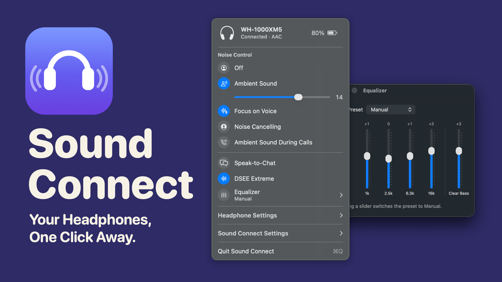
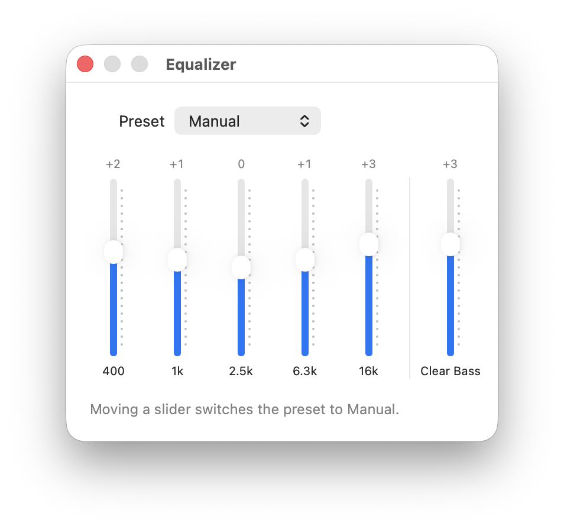

<div align="center">
  <h1>Sound Connect</h1>
  <p><b>Switch noise cancelling, shape the sound and check the battery of your Sony and Bose headphones, right from your menu bar. A tiny, free app for Mac and Linux. No phone needed.</b></p>
  <a href="https://github.com/aecca/sound-connect/releases/latest"></a>
  
  
  <a href="LICENSE"></a>
  <a href="https://github.com/aecca/sound-connect/stargazers"></a>
</div>

<p align="center">
  
</p>

> 💡 **Sound Connect is in beta.** It's new and still being tested, so some things may not work perfectly yet. If you run into a problem, please [let us know](https://github.com/aecca/sound-connect/issues).

## Features

- **No phone needed**: Everything you'd open your headphones' phone app for, one click away in your menu bar or system tray
- **Noise control**: Switch between Noise Cancelling, Ambient Sound and Off, choose how much outside sound you hear, and turn on Focus on Voice
- **Hear yourself on calls**: Switches to Ambient Sound on its own when a call starts, and back when it ends
- **Shape your sound**: Pick an equalizer preset or make your own, and turn on DSEE Extreme to bring back detail in compressed music
- **Battery at a glance**: See each earbud and the case, get a notification when it runs low, and on a Mac, see it next to the menu bar icon
- **Smart settings**: Speak-to-Chat and how readily it notices you, voice prompts, pausing music when you take your headphones off, and when they turn off on their own. On a Mac, you can also turn them off from the menu
- **Buttons your way**: Choose what the noise control button switches between, or have the Bose Action button change noise cancelling
- **Switch devices**: When your Sony headphones are connected to your phone and your computer at once, choose which one you hear
- **One-click connect**: Connect your headphones when they're paired but not connected
- **See every change**: On a Mac, a pop-up shows the new mode when you change it with the button on your headphones or a shortcut
- **Shortcuts and scripts**: Switch modes with a keyboard shortcut in any app, from Shortcuts, Raycast or Alfred, or show your headphones in Waybar

<p align="center">
  <picture>
    <source media="(prefers-color-scheme: dark)" srcset="docs/images/equalizer-dark.png">
    
  </picture>
</p>

## Quick Start

Sound Connect works on macOS 14 or newer, on Apple Silicon and Intel Macs, and on Ubuntu, Omarchy and other Linux systems based on Debian or Arch.

**Install**

Open a terminal, paste this line and press Enter:

```sh
curl -fsSL https://raw.githubusercontent.com/aecca/sound-connect/main/install.sh | bash
```

Sound Connect opens right away, and again every time you log in. On Linux, it may ask for your password to add a few small system packages, but only if they're missing.

**First run**

1. Connect your headphones to your computer in Bluetooth settings, as you normally would.
2. Look for the headphones icon in your menu bar or system tray.
3. On a Mac, you'll be asked whether Sound Connect can use Bluetooth. Click **Allow**.
4. Click the icon to see and change your headphone settings.

**Update**

When there's a new version, **Update** appears in Sound Connect's menu. One click installs it.

## Tiny and Instant

- **Tiny**: About 1.5 MB to download on a Mac, and about 16 MB on Linux
- **Native**: On a Mac, it's a menu bar panel like the Wi-Fi and Sound menus, made with the same tools as the system's own. On Linux, it's a native app too. Neither one hides a web browser inside, as many apps do
- **Instant**: Your headphones change the moment you click. When you press a button on them, Sound Connect shows it right away
- **Out of the way**: It opens when you log in and waits quietly in the menu bar or system tray. No account, no ads, and it works without internet

## Keyboard Shortcut

On a Mac, turn on **Switch Modes with ⌃⌥⌘N** in **Sound Connect Settings**, in Sound Connect's menu. Then press Control-Option-Command-N in any app to go to the next mode.

On Linux, add a keyboard shortcut in your system settings that runs this command:

```sh
sound-connect mode next
```

To go straight to one mode, use `sound-connect mode ambient`, `sound-connect mode noise-cancelling` or `sound-connect mode off` instead, or `noise-cancelling-low` and `wind-reduction` on headphones that have them. If your computer says it can't find `sound-connect`, log out and back in once after installing. On GNOME, shortcuts are in Settings › Keyboard › Keyboard Shortcuts › Custom Shortcuts. On Omarchy and other Hyprland setups, add it to your Hyprland key bindings.

## Shortcuts, Scripts and Status Bars

On a Mac, these links switch modes from the Shortcuts app, Raycast, Alfred or Terminal (`open soundconnect://mode/next`):

- `soundconnect://mode/next`
- `soundconnect://mode/ambient`, `soundconnect://mode/noise-cancelling` or `soundconnect://mode/off`
- `soundconnect://mode/noise-cancelling-low` and `soundconnect://mode/wind-reduction`, on headphones that have them

On Linux, `sound-connect status` shows the mode and battery level, and `sound-connect status --json` gives the same for scripts. Add `--follow` to keep it coming whenever something changes. For example, a [Waybar](https://github.com/Alexays/Waybar) module that shows the battery and switches modes when clicked:

```json
"custom/headphones": {
  "exec": "sound-connect status --json --follow",
  "return-type": "json",
  "format": "🎧 {}",
  "on-click": "sound-connect mode next",
  "restart-interval": 10
}
```

## Supported Headphones

**Sony**

- **WH-1000XM5**
- **WH-1000XM6**
- **WH-CH720N**
- **ULT WEAR** (WH-ULT900N)
- **WF-1000XM6**
- **WF-1000XM5**
- **WF-1000XM4**
- **LinkBuds S**

**Bose**

- **QuietComfort 35**
- **QuietComfort 35 II**

Sound Connect shows only the settings your model has. Older Sony models, such as the WH-1000XM4 and WH-1000XM3, aren't supported yet.

## Something Not Working?

- **I don't see the icon on my Mac.** When the menu bar is full, macOS hides the icons that don't fit beside the camera notch. Hold ⌘ and drag icons you don't need out of the menu bar, or quit menu bar apps you aren't using.
- **I don't see the icon on Linux.** GNOME only shows tray icons with the [AppIndicator extension](https://extensions.gnome.org/extension/615/appindicator-support/). On Omarchy, the icon appears in the top bar's tray. Either way, opening Sound Connect again from your apps shows its panel.
- **It keeps saying "Looking for your headphones".** Make sure they're on and connected to this computer in its Bluetooth settings. If they are, turn them off and on again.
- **On a Mac, it never finds them.** Check that Sound Connect is allowed in System Settings › Privacy & Security › Bluetooth.
- **On Linux, Bluetooth is off.** Turn it on with `sudo systemctl enable --now bluetooth`.
- **I don't see Ambient Sound During Calls.** It needs headphones with Ambient Sound, which the Bose QuietComfort 35 doesn't have. It also needs macOS 14.2 or later on a Mac, and on Linux, PipeWire playing the sound, as on Omarchy, Ubuntu since 22.10 and most other current systems.

Still stuck? [Open an issue](https://github.com/aecca/sound-connect/issues) and include your headphones model and computer.

## Uninstall

```sh
curl -fsSL https://raw.githubusercontent.com/aecca/sound-connect/main/install.sh | bash -s -- --uninstall
```

## Support

- If Sound Connect makes your day a little easier, give it a star or share it with a friend who has Sony or Bose headphones
- Have headphones that aren't supported yet, or an idea? [Open an issue](https://github.com/aecca/sound-connect/issues)

## Free and Open Source

Sound Connect is free and open source, released under the [MIT License](LICENSE). Anyone can use it, share it and help make it better. If you'd like to help, see [how it's built](docs/DEVELOPMENT.md).

## Your Privacy

Sound Connect talks directly to your headphones over Bluetooth. It doesn't need an account and doesn't collect anything. It only goes online to ask GitHub whether there's a new version, when it starts and once a day after that, and to download the new version when you click **Update**.

## Not Affiliated with Sony or Bose

Sound Connect is an independent project. It isn't made, endorsed or supported by Sony or Bose. Sony, Bose and the product names mentioned here are trademarks of their owners.

## Thanks

Sound Connect builds on the work of open-source projects that figured out how these headphones communicate, especially [Gadgetbridge](https://gadgetbridge.org), [SonyHeadphonesClient](https://github.com/mos9527/SonyHeadphonesClient), [Sony Device Center](https://github.com/marconvcm/sony-device-center) and [acouplet](https://github.com/baglayan/acouplet) for Sony, and [bosectl](https://github.com/alabalag1/bosectl) and [based-connect](https://github.com/Denton-L/based-connect) for Bose.
