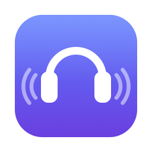
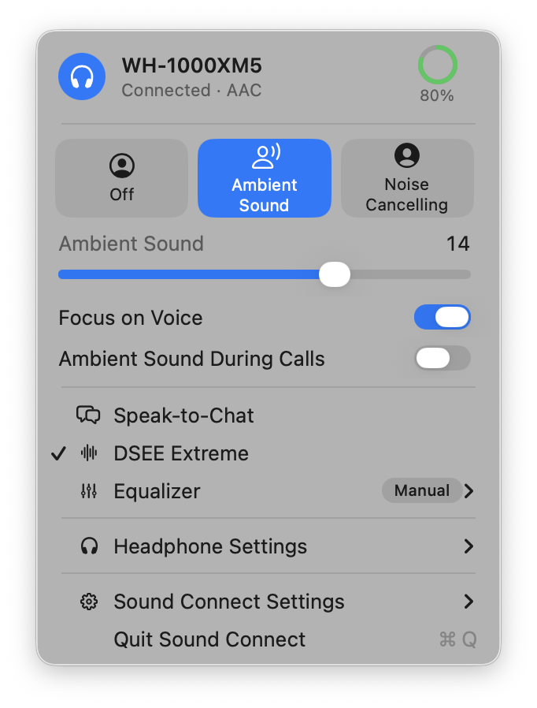

<p align="center">
  
</p>

<h1 align="center">Sound Connect</h1>

<p align="center">
  Control your Sony and Bose headphones from your Mac or Linux computer.<br>
  No phone needed.
</p>

<p align="center">
  <a href="https://github.com/aecca/sound-connect/releases/latest"></a>
  
  
  <a href="LICENSE"></a>
</p>

<p align="center">
  <picture>
    <source media="(prefers-color-scheme: dark)" srcset="docs/images/menu-dark.png">
    
  </picture>
</p>

> [!NOTE]
> **Sound Connect is in beta.** It's new and still being tested, so some things may not work perfectly yet. If you run into a problem, please [let us know](https://github.com/aecca/sound-connect/issues).

## Install

Open a terminal, paste this line and press Enter:

```sh
curl -fsSL https://raw.githubusercontent.com/aecca/sound-connect/main/install.sh | bash
```

That's it. It works on **Mac**, **Ubuntu** and **Omarchy**, and on other Linux systems based on Debian or Arch. Sound Connect opens right away, and again every time you log in.

On Linux, it may ask for your password to add a few small system packages, but only if they're missing.

When there's a new version, **Update** appears in Sound Connect's menu. One click installs it.

## What you can do

Sound Connect sits in your menu bar (or your system tray on Linux). Click the headphones icon to:

- 🎧 Switch between **Noise Cancelling**, **Ambient Sound** and **Off**
- 🔊 Choose how much outside sound you hear, and turn on **Focus on Voice**
- 💬 Turn **Speak-to-Chat** on or off, the feature that lets in outside sound when you start talking, and choose how readily it notices you and when it goes back
- 📞 Switch to **Ambient Sound during calls** on its own, so you hear your own voice, and back when the call ends
- 🎚️ Pick an **equalizer** preset, or shape your own sound
- ✨ Turn on **DSEE Extreme** to bring back detail in compressed music
- 🔕 Turn **voice prompts** on or off, and choose when your headphones **turn off** on their own
- ⏸️ **Pause music** when you take your headphones off
- 🔘 Choose what the **noise control button** on your headphones switches between, or have the **Action button** on Bose headphones change noise cancelling
- 🔋 See your **battery level**, including each earbud and the case, and get a **notification** when it runs low
- 🔗 **Connect** your headphones with one click when they're paired but not connected
- ⌨️ Switch modes with a **keyboard shortcut**, from any app

If you change the mode with the button on your headphones, Sound Connect shows the change right away.

<p align="center">
  <picture>
    <source media="(prefers-color-scheme: dark)" srcset="docs/images/equalizer-dark.png">
    
  </picture>
</p>

On Linux, the equalizer, DSEE and one-click connect are coming soon.

## Light and fast

- **Small.** About 1 MB to download on a Mac, and about 15 MB on Linux.
- **Native.** On a Mac, it's a real macOS menu, made with the same tools as the system's own. On Linux, it's a native app too. Neither one hides a web browser inside, as many apps do.
- **Instant.** Your headphones change the moment you click. When you press a button on them, Sound Connect shows it right away.
- **Out of the way.** It opens when you log in and waits quietly in the menu bar or system tray. No account, no ads, and it works without internet.

## Keyboard shortcut

On a Mac, turn on **Switch Modes with ⌃⌥⌘N** in Sound Connect's menu. Then press Control-Option-Command-N in any app to go to the next mode.

On Linux, add a keyboard shortcut in your system settings that runs this command:

```sh
sound-connect mode next
```

To go straight to one mode, use `sound-connect mode ambient`, `sound-connect mode noise-cancelling` or `sound-connect mode off` instead. On GNOME, shortcuts are in Settings › Keyboard › Keyboard Shortcuts › Custom Shortcuts. On Omarchy and other Hyprland setups, add it to your Hyprland key bindings.

## Shortcuts, scripts and status bars

On a Mac, these links switch modes from the Shortcuts app, Raycast, Alfred or Terminal (`open soundconnect://mode/next`):

- `soundconnect://mode/next`
- `soundconnect://mode/ambient`, `soundconnect://mode/noise-cancelling` or `soundconnect://mode/off`

On Linux, `sound-connect status` shows the mode and battery level, and `sound-connect status --json` gives the same for scripts. Add `--follow` to keep it coming whenever something changes. For example, a [Waybar](https://github.com/Alexays/Waybar) module that shows the battery and switches modes when clicked:

```json
"custom/headphones": {
  "exec": "sound-connect status --json --follow",
  "return-type": "json",
  "format": "🎧 {}",
  "on-click": "sound-connect mode next",
  "restart-interval": 10
}
```

## Supported headphones

**Sony**

- **WH-1000XM5**
- **WH-1000XM6**
- **WH-CH720N**
- **ULT WEAR** (WH-ULT900N)
- **WF-1000XM6**
- **WF-1000XM5**
- **WF-1000XM4**
- **LinkBuds S**

**Bose**

- **QuietComfort 35**
- **QuietComfort 35 II**

Sound Connect shows only the settings your model has. Older Sony models, such as the WH-1000XM4 and WH-1000XM3, aren't supported yet.

## First time

1. Connect your headphones to your computer in Bluetooth settings, as you normally would.
2. Look for the headphones icon in your menu bar or system tray.
3. On a Mac, you'll be asked whether Sound Connect can use Bluetooth. Click **Allow**.
4. Click the icon to see and change your headphone settings.

## Something not working?

- **I don't see the icon on my Mac.** When the menu bar is full, macOS hides the icons that don't fit beside the camera notch. Hold ⌘ and drag icons you don't need out of the menu bar, or quit menu bar apps you aren't using.
- **I don't see the icon on Linux.** GNOME only shows tray icons with the [AppIndicator extension](https://extensions.gnome.org/extension/615/appindicator-support/). On Omarchy, the icon appears in the top bar's tray. Either way, opening Sound Connect again from your apps shows its panel.
- **It keeps saying "Looking for your headphones".** Make sure they're on and connected to this computer in its Bluetooth settings. If they are, turn them off and on again.
- **On a Mac, it never finds them.** Check that Sound Connect is allowed in System Settings › Privacy & Security › Bluetooth.
- **On Linux, Bluetooth is off.** Turn it on with `sudo systemctl enable --now bluetooth`.

Still stuck? [Open an issue](https://github.com/aecca/sound-connect/issues) and include your headphones model and computer.

## Uninstall

```sh
curl -fsSL https://raw.githubusercontent.com/aecca/sound-connect/main/install.sh | bash -s -- --uninstall
```

## Free and open source

Sound Connect is free and open source, released under the [MIT License](LICENSE). Anyone can use it, share it and help make it better. If you'd like to help, see [how it's built](docs/DEVELOPMENT.md).

## Your privacy

Sound Connect talks directly to your headphones over Bluetooth. It doesn't need an account and doesn't send anything over the internet.

## Not affiliated with Sony or Bose

Sound Connect is an independent project. It isn't made, endorsed or supported by Sony or Bose. Sony, Bose and the product names mentioned here are trademarks of their owners.

## Thanks

Sound Connect builds on the work of open-source projects that figured out how these headphones communicate, especially [Gadgetbridge](https://gadgetbridge.org), [SonyHeadphonesClient](https://github.com/mos9527/SonyHeadphonesClient) and [Sony Device Center](https://github.com/marconvcm/sony-device-center) for Sony, and [bosectl](https://github.com/alabalag1/bosectl) and [based-connect](https://github.com/Denton-L/based-connect) for Bose.
